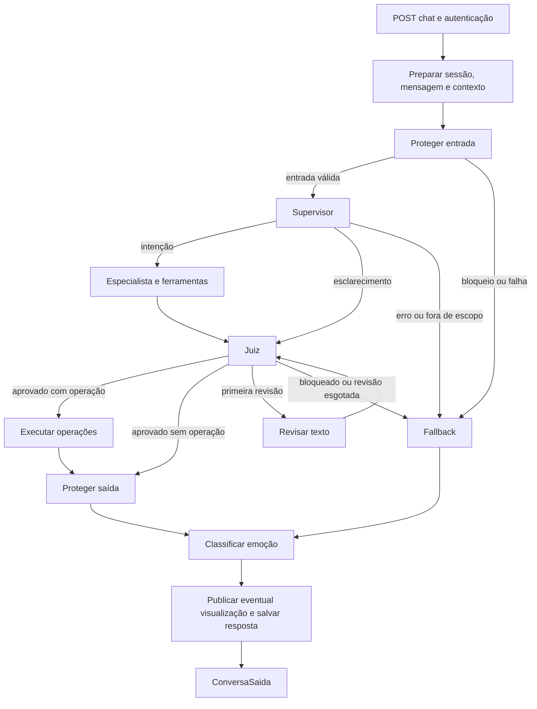
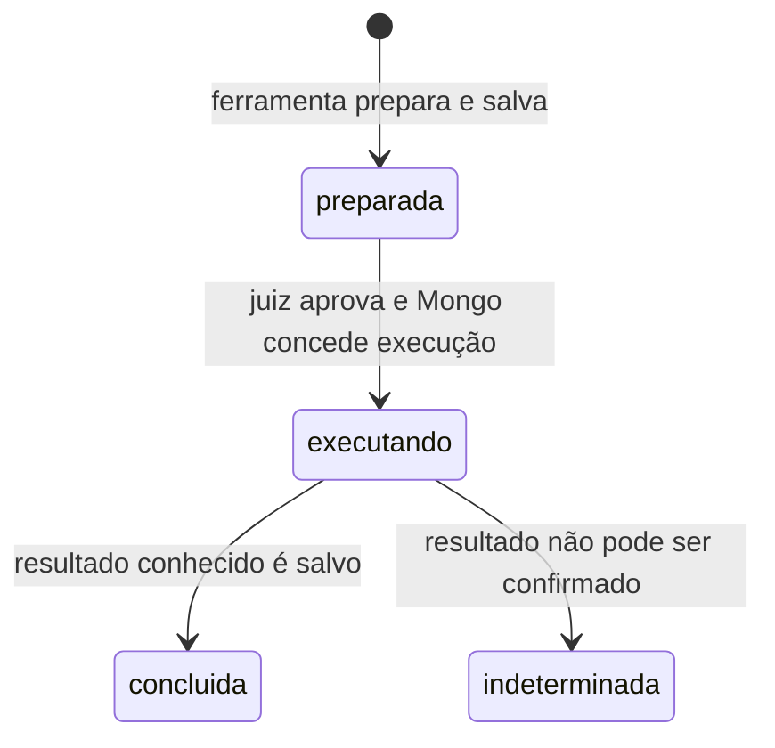
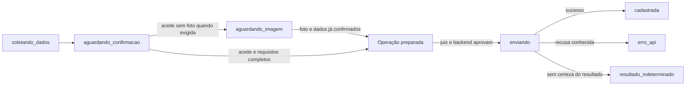
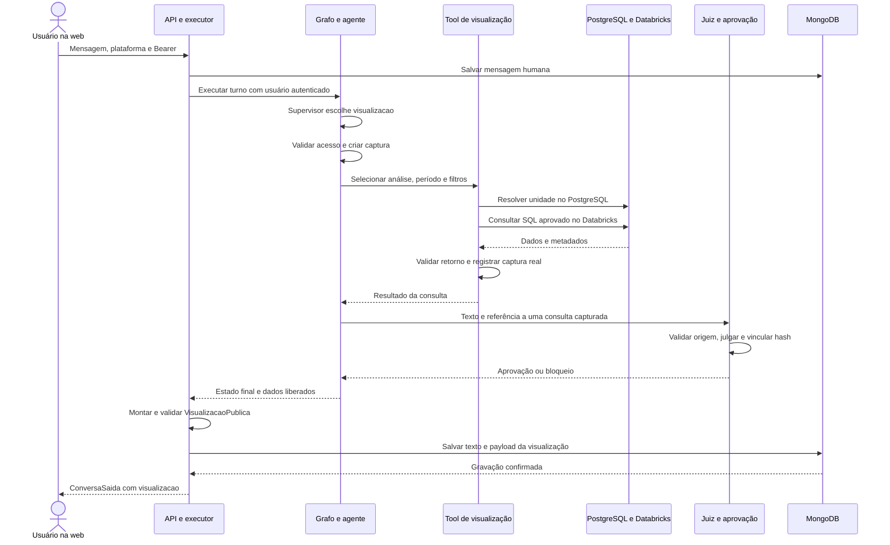

# Guia dos fluxos da aplicação FIXA

Análise do código presente no workspace em **6 de novembro de 2026**, incluindo as alterações locais já existentes em `app/services/chat.py` e `app/memory/persistencia/sessoes/inicio.py`.

Este guia explica o backend de IA deste repositório. Não há aqui a implementação das telas do aplicativo nem do backend externo FIXA. Portanto, o comportamento dessas partes só pode ser descrito pelos contratos e chamadas encontrados. A análise foi estática: não foram feitas operações em bancos, chamadas reais a modelos ou cadastros na API.

## Como usar este guia

Leia primeiro as seções 1–5, que explicam o caminho compartilhado. Depois escolha uma jornada nas seções 6–16. A seção 11 detalha visualizações de ponta a ponta. As seções finais explicam persistência, falhas e uma ordem prática de estudo.

- [Arquitetura e responsabilidades](#1-arquitetura-e-responsabilidades)
- [Entrada HTTP e autenticação](#2-entrada-http-e-autenticação)
- [Preparação de cada mensagem](#3-preparação-de-cada-mensagem)
- [Supervisor e continuidade](#4-supervisor-e-continuidade)
- [Juiz, operações e resposta](#5-juiz-operações-e-resposta)
- [FAQ](#6-dúvidas-sobre-o-aplicativo-faq)
- [Consultas de registros](#7-consultas-de-registros-ajuda-geral)
- [Criar solicitação, ocorrência e evento](#8-criar-solicitação-ocorrência-e-evento)
- [Atualizar solicitação e ocorrência](#9-atualizar-solicitação-e-ocorrência)
- [Anexar fotos a observações](#10-anexar-fotos-a-observações-de-conclusão)
- [Visualizações completas](#11-visualizações-fluxo-completo)
- [Indicadores](#12-indicadores-analytics)
- [Compras](#13-pesquisa-de-compras)
- [Feedback](#14-registrar-e-consultar-feedback)
- [Histórico e encerramento](#15-histórico-encerramento-e-exclusão-de-conversas)
- [Classificação independente](#16-classificação-de-problemas-fora-do-chat)
- [Persistência](#17-onde-os-dados-ficam)
- [Falhas e limites](#18-falhas-limites-e-comportamentos-que-merecem-atenção)
- [Roteiro de estudo e testes](#19-roteiro-para-dominar-e-explicar-o-código)

## 1. Arquitetura e responsabilidades

O sistema combina decisões de modelos com regras Python. O modelo interpreta pedidos, escolhe ferramentas e redige respostas. O backend valida identidade, escopo, contratos, propostas, aprovação e execução.

| Camada | Responsabilidade | Onde começar |
| --- | --- | --- |
| API | Receber HTTP, validar contratos e obter usuário | `app/api/routes/`, `app/api/dependencies/` |
| Serviços de entrada | Coordenar chat, sessões e classificação | `app/services/chat.py`, `sessao.py`, `classificacao_problema.py` |
| Grafo | Definir ordem de execução e desvios | `app/graph/fluxo.py`, `nos.py`, `transicoes.py` |
| Agentes | Compor modelo, prompt, ferramentas e formato de saída | `app/agents/` |
| Prompts | Orientar interpretação e comportamento por perfil | `app/agents/prompts/` |
| Ferramentas | Adaptar argumentos do modelo ao contexto autenticado e ao domínio | `app/tools/` |
| Serviços de domínio | Consultar dados, aplicar regras e executar gravações | `app/services/solicitacoes/`, `ocorrencias/`, `visualizacoes/` etc. |
| Contratos | Tipar e validar entradas, saídas e estruturas internas | `app/schemas/` |
| Persistência e memória | Guardar conversas/propostas e recuperar contexto | `app/memory/` |
| Clientes | Centralizar conexões e modelos compartilhados | `app/core/clients/` |
| Regras comuns | Confirmação, enums, tempo, apresentação e projeções | `app/core/` |
| Observabilidade | Medir duração, uso, custo estimado e resultados | `app/observability/`, `observability/` |

**Agente, ferramenta e serviço são coisas diferentes.** Por exemplo: o agente de solicitações decide usar `criar_solicitacao`; essa ferramenta verifica o rascunho e prepara uma operação; depois da aprovação, o executor a chama novamente com os dados aprovados, e o serviço `adicionar_solicitacao` faz o POST externo.

O registro dos agentes por perfil está em [app/agents/registro.py:108 - `selecionar_agente`](../app/agents/registro.py#L108). A fábrica que escolhe ferramentas de cadastros está em [app/agents/solicitacoes.py:22 - `criar_agente_solicitacoes`](../app/agents/solicitacoes.py#L22).

Os nomes `llm_rapido`, `llm_especialista` e `llm_luna` apontam, atualmente, para o mesmo cliente configurado no arquivo [core/clients/modelos.py](../app/core/clients/modelos.py). Os papéis diferem por prompt, ferramentas e contrato. O juiz usa o serviço JEV/Typesafe em [app/services/gerais/jev.py:26 - `consultar_jev`](../app/services/gerais/jev.py#L26). Os nomes dos aliases não significam que três modelos distintos sejam usados.

## 2. Entrada HTTP e autenticação

### 2.1 Inicialização da aplicação

[app/main.py:22 - `lifespan`](../app/main.py#L22) inicia os clientes de MongoDB e Qdrant, garante índices de sessões, FAQ, histórico e coleções operacionais e registra o fechamento dos recursos. A aplicação recebe os roteadores com prefixo `/api/v1`.

Criar índice não equivale a alimentar as coleções com os dados de negócio. A ingestão de FAQ é um processo separado, descrito na seção 17.

### 2.2 Superfície HTTP deste repositório

| Requisição | Jornada | Entrada no código |
| --- | --- | --- |
| `POST /api/v1/chat` | Conversar; criar sessão se não houver `thread_id` | [app/api/routes/chat.py:19 - `conversar`](../app/api/routes/chat.py#L19) |
| `DELETE /api/v1/chat/sessions/{thread_id}` | Encerrar e resumir conversa | [app/api/routes/chat.py:37 - `encerrar_conversa`](../app/api/routes/chat.py#L37) |
| `GET /api/v1/sessoes` | Listar conversas do usuário | [app/api/routes/sessoes.py:32 - `pegar_todas_conversas_usuario`](../app/api/routes/sessoes.py#L32) |
| `POST /api/v1/sessoes/conversa` | Recuperar conversa por `session_id` | [app/api/routes/sessoes.py:61 - `pegar_conversa_especifica`](../app/api/routes/sessoes.py#L61) |
| `DELETE /api/v1/sessoes/conversa/{session_id}` | Ocultar conversa no histórico | [app/api/routes/sessoes.py:91 - `excluir_conversa_historico`](../app/api/routes/sessoes.py#L91) |
| `POST /api/v1/classificar/classificar-problema` | Classificar problema sem executar o grafo do chat | [app/api/routes/classificacao_problema.py:12 - `classificar_problema`](../app/api/routes/classificacao_problema.py#L12) |
| `GET /api/v1/health` | Verificar resposta básica do processo | [app/api/routes/health.py:14 - `health_check`](../app/api/routes/health.py#L14) |
| `GET /api/v1/metrics` | Ler métricas Prometheus | [app/api/routes/metrics.py:11 - `metrics`](../app/api/routes/metrics.py#L11) |

Chat e sessões usam `Depends(obter_usuario_atual)`. As rotas de classificação, health e métricas não declaram essa dependência no código analisado.

### 2.3 Quem identifica o usuário

[app/api/dependencies/auth.py:15 - `obter_usuario_atual`](../app/api/dependencies/auth.py#L15) exige `Authorization: Bearer ...`. A validação do token é delegada ao FIXA: [app/services/gerais/perfil.py:13 - `consultar_perfil`](../app/services/gerais/perfil.py#L13) chama `GET {FIXA_API_BASE_URL}/api/v1/perfil` com esse token.

O resultado vira [app/schemas/UsuarioContexto.py:7 - `UsuarioContexto`](../app/schemas/UsuarioContexto.py#L7), com ID, perfil, nome, e-mail, CNPJ da unidade e token. O perfil é normalizado; `Técnico` vira `tecnico`. O CNPJ fica apenas com dígitos e precisa ter 14 caracteres; esse validador não verifica os dígitos verificadores.

Ausência de credencial gera 401; o FIXA pode resultar em 401/403; indisponibilidade na consulta gera 503; resposta de perfil incompatível gera 502. O usuário não fornece seu próprio perfil, unidade ou token nos argumentos das ferramentas.

Para operações que precisam da unidade, [app/services/gerais/unidade.py:7 - `obter_unidade_id`](../app/services/gerais/unidade.py#L7) consulta PostgreSQL usando ID e CNPJ do contexto. Exige usuário e unidade ativos e exatamente uma unidade válida. Essa verificação é usada por ferramentas de busca, edição e análises.

### 2.4 Contrato da mensagem

[app/schemas/chat.py:7 - `ConversaEntrada`](../app/schemas/chat.py#L7) exige:

- `mensagem`: texto aparado, de 1 a 4.000 caracteres;
- `plataforma`: `web` ou `mobile`;
- `thread_id`: opcional, com limites definidos no contrato de sessão;
- `imagens`: até três URLs por mensagem.

[app/schemas/imagem.py:21 - `validar_url_imagem`](../app/schemas/imagem.py#L21) aceita URLs HTTP(S) de até 255 caracteres, sem credenciais, fragmento, host local ou IP não público. Trata a estrutura da URL; não baixa a imagem nem confirma o conteúdo visual ou a disponibilidade do arquivo.

**Enviar somente foto com `mensagem` vazia não passa por esse contrato HTTP**, mesmo que existam tratamentos internos para mensagem vazia com imagens no grafo. Uma mensagem como “segue a foto” pode acompanhar as URLs.

## 3. Preparação de cada mensagem

### 3.1 Sessão nova ou existente

[app/services/chat.py:24 - `_processar_chat`](../app/services/chat.py#L24) verifica se o perfil está entre `solicitante`, `tecnico`, `gestor` e `administrador`.

Sem `thread_id`, gera um UUID e chama [app/memory/persistencia/sessoes/inicio.py:6 - `iniciar_sessao`](../app/memory/persistencia/sessoes/inicio.py#L6). Com ID, chama [app/memory/persistencia/utilitarios.py:35 - `sessao_acessivel`](../app/memory/persistencia/utilitarios.py#L35) e exige que a sessão pertença ao usuário e esteja ativa no MongoDB; caso contrário, responde 404.

### 3.2 O papel de executor.py, seu arquivo aberto

[app/graph/executor.py:96 - `executar_grafo`](../app/graph/executor.py#L96) envolve a execução do LangGraph. A sequência é:

1. Compõe a chave interna `usuario_id:thread_id`, isolando checkpoints de usuários diferentes.
2. Anonimiza padrões de dados pessoais com [app/guardrails/validacao.py:136 - `anonimizar_entrada`](../app/guardrails/validacao.py#L136).
3. Consulta `grafo.get_state`. Se não houver checkpoint, recupera mensagens do MongoDB e as converte para `HumanMessage` e `AIMessage`.
4. Acrescenta a nova mensagem humana e a salva no MongoDB **antes de executar o grafo**, com as URLs de imagem recebidas. Nesse ponto usa `associar_imagens=False`; a associação ao cadastro é tratada depois.
5. Carrega rascunhos de solicitação, ocorrência e evento, ação de ajuda geral, análise de compra e quantidade de anexos pendentes.
6. Cria o estado inicial e o contexto da execução.
7. Executa `grafo.ainvoke(estado_inicial, config=..., context=...)`.
8. Confere resposta, publica eventual visualização e salva a mensagem do assistente.
9. Registra quais propostas foram efetivamente apresentadas e marca `confirmacao` quando cabível.
10. Entrega o resultado ao serviço, que monta `ConversaSaida`.

[app/graph/executor.py:42 - `criar_estado_inicial`](../app/graph/executor.py#L42) reinicia os controles do turno: tentativas, erro, evidências, aprovação, respostas e visualização. `messages` usa o redutor `add_messages`, declarado em [app/graph/estado.py:7 - `EstadoGrafo`](../app/graph/estado.py#L7), para integrar as novas mensagens ao checkpoint existente.

### 3.3 Estado e contexto

| Estrutura | Exemplos | Função |
| --- | --- | --- |
| `EstadoGrafo` | mensagens, intenção, evidências, veredito, resposta, referências de visualização | Dados que os nós leem/atualizam e que participam do checkpoint |
| `ContextoGrafo` | usuário autenticado, token dentro do usuário, sessão, turno, plataforma, imagens | Dados da execução injetados pelo servidor nas ferramentas |
| MongoDB | mensagens, rascunhos versionados, ações e operações | Recuperação durável entre requisições/reinícios |

Contrato do contexto: [app/graph/contexto.py:5 - `ContextoGrafo`](../app/graph/contexto.py#L5). O `turno_id` é um UUID novo para cada chamada de `executar_grafo`; identifica uma execução de mensagem, enquanto `thread_id` identifica a conversa.

O checkpoint usa `MemorySaver` em [app/graph/fluxo.py:63 - `construir_grafo`](../app/graph/fluxo.py#L63). Ele fica na memória do processo. Ao reiniciar, mensagens e rascunhos podem ser recuperados do MongoDB, mas isso não restaura todos os campos internos do checkpoint anterior.

## 4. Supervisor e continuidade

### 4.1 Caminho principal do grafo



As arestas reais estão em [app/graph/fluxo.py:63 - `construir_grafo`](../app/graph/fluxo.py#L63) e as decisões em [transicoes.py](../app/graph/transicoes.py). Há um atalho específico: visualização solicitada no mobile segue diretamente à classificação de emoção com uma resposta de bloqueio, sem consulta analítica ou julgamento daquele pedido.

### 4.2 Proteção da entrada

[app/graph/nos.py:92 - `validar_entrada`](../app/graph/nos.py#L92) limpa visualizações herdadas e verifica pergunta/perfil. [app/guardrails/validacao.py:213 - `proteger_entrada`](../app/guardrails/validacao.py#L213) aplica expressões regulares contra tentativas de alterar instruções e pedir dados internos; depois consulta um classificador estruturado para pedidos perigosos ou ilícitos.

Se o classificador de segurança falhar, as regras determinísticas continuam valendo e a função aprova a entrada. Portanto, indisponibilidade desse classificador não bloqueia, por si só, todo o chat. Esse comportamento difere de falhas do juiz, que impedem a aprovação da resposta.

### 4.3 Escolha do especialista

[app/graph/nos.py:172 - `supervisionar`](../app/graph/nos.py#L172) tenta primeiro resolver continuação, pausa e cancelamento por regras de [app/graph/continuacoes.py:39 - `tratar_continuacao`](../app/graph/continuacoes.py#L39). Se essas regras não resolverem, chama [app/agents/orquestrador.py:97 - `rotear_orquestrador`](../app/agents/orquestrador.py#L97).

O orquestrador considera a mensagem, perfil, as últimas 12 mensagens humanas/IA, propostas ativas e pausadas, imagens e contexto temporal. Retorna `DecisaoRoteamento`: intenção, continuidade, necessidade de esclarecer e operação de criar/atualizar. Contagens pessoais explícitas e pedidos explícitos de pesquisa de compras têm regras de encaminhamento anteriores à consulta do roteador LLM. `pedido_contagem_pessoal` encaminha contagens simples próprias para ajuda geral, sem iniciar/retomar cadastro. Pedidos mistos, gráficos, dúvidas de uso e análises gerenciais continuam no roteador contextual.

| Pedido do usuário | Destino esperado |
| --- | --- |
| “Como crio uma solicitação?” | `faq` |
| “Quais solicitações estão pendentes?” | `ajuda_geral` |
| “Quantas solicitações estão pendentes?” | `analytics` |
| “Quantas solicitações eu tenho?” | `ajuda_geral` |
| “Quantas das minhas solicitações estão pendentes?” | `ajuda_geral` |
| “Quantas ocorrências registrei?” | `ajuda_geral`, com autorização de perfil na ferramenta |
| “Quantas OS estão atribuídas a mim?” | `ajuda_geral`, com autorização de perfil na ferramenta |
| “Qual o total dos meus feedbacks?” | `ajuda_geral` |
| “O ar precisa de reparo, quero registrar” | `solicitacao` |
| “Já fiz a manutenção, quero registrar” | `ocorrencia` |
| “Altere a descrição da minha solicitação” | `solicitacao`, operação `atualizar` |
| “Agende um evento para amanhã” | `evento` |
| “Mostre um gráfico de OS por mês” | `visualizacao` |
| “Quero registrar uma sugestão” | `feedback` |
| “Onde comprar uma furadeira?” | `analista_compras` |

Essa tabela representa as instruções e regras do roteador; uma chamada real de modelo ainda pode classificar incorretamente. As permissões são verificadas novamente depois do roteamento.

### 4.4 Interromper, corrigir e retomar

[app/core/confirmacoes.py:57 - `classificar_manifestacao`](../app/core/confirmacoes.py#L57) examina a mensagem inteira. “Sim” pode ser aceite; “sim, mas troque o local” não libera uma gravação. Perguntas, negações, cancelamentos e pausas são distinguidos.

Ao mudar de assunto, o supervisor pode pausar propostas anteriores no MongoDB. Retomar uma proposta pausada exige identificação suficiente. Um “sim” isolado não escolhe entre várias propostas nem retoma automaticamente uma proposta pausada. Ambiguidade produz uma pergunta de esclarecimento.

Pausar preserva os dados. Cancelar altera o estado da proposta para `cancelada`. Retomar reativa a proposta escolhida e pausa outras. Fonte: [app/graph/continuacoes.py:14 - `alterar_continuacao`](../app/graph/continuacoes.py#L14) e [app/graph/continuacoes.py:92 - `pausar_outros_fluxos`](../app/graph/continuacoes.py#L92).

## 5. Juiz, operações e resposta

### 5.1 O que conta como evidência

[app/graph/evidencias.py:69 - `executar_com_evidencias`](../app/graph/evidencias.py#L69) invoca o agente e [app/graph/evidencias.py:19 - `extrair_evidencias`](../app/graph/evidencias.py#L19) extrai retornos de chamadas novas de ferramentas. Guarda ferramenta, chamada, status de execução, status do negócio e resultado.

`status_execucao=success` significa que a ferramenta respondeu. O resultado pode ser `AGUARDANDO_INFORMACAO`, `ACESSO_NEGADO`, erro ou operação apenas preparada. Uma resposta anterior do assistente ou um resumo de memória não comprova uma gravação atual.

As evidências são devolvidas ao grafo pelo nó; o juiz as compara com a resposta candidata. As operações preparadas pelas ferramentas também são acumuladas no contexto e copiadas para julgamento.

### 5.2 Julgamento e revisão

[app/agents/juiz.py:228 - `julgar_resposta`](../app/agents/juiz.py#L228) coordena o julgamento. O juiz recebe perfil, políticas, pergunta, histórico recente, evidências, propostas, texto e operações pendentes. Usa JEV para decidir `aprovado`, `revisar` ou `bloqueado`, com regras adicionais do backend.

Exemplos dessas regras: confiança abaixo de 0,35 bloqueia; risco grave a partir de 0,50 bloqueia; afirmação sem suporte pode exigir revisão ou bloqueio. Para visualização, incompatibilidade material da consulta bloqueia a entrega. Os critérios completos ficam em [app/agents/juiz.py:281 - `_julgar_resposta`](../app/agents/juiz.py#L281).

[app/graph/transicoes.py:28 - `decidir_apos_julgamento`](../app/graph/transicoes.py#L28) permite **uma revisão textual**: quando o primeiro julgamento pede revisão, `tentativas` vira 1; o revisor produz outro texto e o juiz avalia novamente. Uma nova necessidade de revisão leva ao fallback. O juiz ainda pode fazer uma reavaliação interna de uma decisão inconclusiva; isso é diferente da volta ao nó revisor.

[app/agents/juiz.py:111 - `revisar_resposta`](../app/agents/juiz.py#L111) não recebe ferramentas para cadastrar nem trocar os dados de um gráfico. Algumas respostas padronizadas e verificadas pelo backend têm tratamento determinístico, sem uma avaliação JEV comum.

### 5.3 Preparar uma operação não é executá-la

[app/services/operacoes.py:24 - `preparar_operacao`](../app/services/operacoes.py#L24) cria um documento durável em `operacoes_chat`, com identidade, tipo, dados, hash e estado `preparada`. Retorna `OPERACAO_PREPARADA` e o juiz ainda precisa aprovar.

[app/services/operacoes.py:53 - `aprovacao_operacoes`](../app/services/operacoes.py#L53) vincula a aprovação a usuário, sessão, turno e hash do conjunto exato de operações. [app/graph/operacoes.py:58 - `executar_operacoes`](../app/graph/operacoes.py#L58) compara a aprovação com o estado e com o documento salvo antes de executar.



`concluida` significa processamento concluído com resultado conhecido, que também pode ser uma recusa/erro de negócio. O sucesso é identificado no campo `resultado.status`.

A transição `preparada → executando` usa atualização condicional no MongoDB, para que só um executor a adquira. Uma operação concluída reaproveita o resultado; uma operação em estado incerto não é reenviada automaticamente. Fonte: [persistencia/operacoes.py](../app/memory/persistencia/operacoes.py).

O despacho em [app/graph/operacoes.py:15 - `executar_servico`](../app/graph/operacoes.py#L15) aceita apenas sete tipos: solicitação, ocorrência, evento, feedback, edição, atualização de solicitação e atualização de ocorrência.

### 5.4 Texto final, emoção e retorno

Depois da execução, [app/graph/operacoes.py:49 - `resposta_resultados`](../app/graph/operacoes.py#L49) monta uma confirmação factual usando o resultado real. Esse texto passa pela proteção de saída; não há uma nova volta normal ao juiz depois da gravação.

[app/guardrails/validacao.py:259 - `proteger_saida`](../app/guardrails/validacao.py#L259) omite marcadores e padrões de dados pessoais sem pedir a outro modelo para reescrever a resposta. No fluxo de compras, URLs HTTPS comprovadas das ofertas são preservadas durante esse tratamento.

[app/agents/emocoes.py:117 - `classificar_emocao`](../app/agents/emocoes.py#L117) escolhe a expressão da personagem. Prioriza erros/bloqueios por regras e, quando necessário, consulta JEV com timeout de cinco segundos. Falha nessa classificação usa uma alternativa e não exige mudar o texto aprovado.

[app/schemas/chat.py:42 - `ConversaSaida`](../app/schemas/chat.py#L42) entrega `thread_id`, `intencao`, `resposta`, `emocao`, `confirmacao` e, quando presente, `visualizacao`. `confirmacao="sim"` indica uma proposta apresentada que aguarda confirmação; **não significa cadastro concluído**. A emoção `CONFIRMACAO` também é um dado de apresentação, separado desse campo.

## 6. Dúvidas sobre o aplicativo: FAQ

**Exemplo:** “Como acompanho uma solicitação no aplicativo?” Todos os quatro perfis têm um agente FAQ.

1. O supervisor escolhe `faq`; [app/graph/nos.py:314 - `executar_faq`](../app/graph/nos.py#L314) seleciona o agente do perfil.
2. O agente usa [app/tools/faq/buscar.py:9 - `buscar_faq`](../app/tools/faq/buscar.py#L9) para buscar trechos.
3. A ferramenta obtém o perfil do contexto autenticado e gera um embedding da pergunta.
4. Consulta a coleção `faq_fixa` no Qdrant, filtrando `perfil` e recuperando até seis trechos. Administrador usa o conteúdo de gestor.
5. O agente devolve `FAQResultado`; o nó exige esse tipo. Ausência de informação tem tratamento padronizado.
6. A resposta passa por juiz, eventual revisão, proteção de saída, emoção e salvamento no MongoDB.

**Persistência:** a pergunta e a resposta ficam na sessão; a busca não cria um registro de manutenção. O conteúdo do FAQ vem de documentos previamente ingeridos, não de uma leitura das telas em tempo real.

**Onde estudar:** [agents/faq.py](../app/agents/faq.py), [app/tools/faq/buscar.py:9 - `buscar_faq`](../app/tools/faq/buscar.py#L9), [prompts/especialistas/faq.py](../app/agents/prompts/especialistas/faq.py).

## 7. Consultas de registros: ajuda geral

**Exemplos:** “Minhas solicitações”, “qual a situação do problema 10?”, “quais equipamentos ficam no laboratório?”

[app/graph/nos.py:253 - `executar_ajuda_geral`](../app/graph/nos.py#L253) escolhe um agente com ferramentas diferentes por perfil. A composição completa está em [app/agents/ajuda_geral.py:51 - `criar_agente_ajuda_geral`](../app/agents/ajuda_geral.py#L51). O resultado estruturado usa `FAQResultado`, apesar do nome do agente ser ajuda geral.

### 7.1 Caminhos de consulta

| Caminho | Como funciona | Validação/fonte |
| --- | --- | --- |
| Busca operacional genérica | Busca semântica, busca literal, similares, múltiplas coleções ou listagem com cursor | Qdrant, lista de coleções permitidas, atividade e unidade; problemas do solicitante ainda são filtrados por autoria via SQL |
| Consulta relacional enriquecida | SQL encontra IDs e metadados exatos; Qdrant fornece descrições desses IDs | Retorna somente registros que também tenham ponto ativo e autorizado no Qdrant |
| Listagens específicas | Consultas SQL de solicitações, ocorrências, OS, feedback e técnicos | Regras de autoria/perfil, unidade, atividade, período e limite específicas de cada função |
| Contagem pessoal | `COUNT(*)` no PostgreSQL, sem usar o tamanho de uma lista ou amostra vetorial | Usuário e unidade autenticados; atividade; situação e período de criação opcionais |

Fontes: [app/services/ajuda_geral/consultas.py:194 - `buscar_semanticamente`](../app/services/ajuda_geral/consultas.py#L194), [app/services/ajuda_geral/consultas.py:260 - `listar_registros`](../app/services/ajuda_geral/consultas.py#L260) e [app/services/ajuda_geral/consultas_relacionais.py:37 - `_consultar`](../app/services/ajuda_geral/consultas_relacionais.py#L37).

Na busca genérica, `marca_equipamento` é a coleção global; as demais aplicam filtro de unidade. Um solicitante tem acesso a um subconjunto de coleções e só aos seus próprios problemas. Os retornos do Qdrant são revalidados, inclusive ID, texto, atividade e unidade.

### 7.2 Jornadas de consulta disponíveis

| Jornada | Perfil/filtro relevante | Serviço |
| --- | --- | --- |
| Quantas solicitações/feedbacks tenho | Todos os perfis; somente próprios; sem limite de três registros | [contagens.py](../app/services/ajuda_geral/contagens.py) |
| Quantas ocorrências/OS tenho | Técnico/gestor/administrador; ocorrências próprias e OS atribuídas ao usuário | [contagens.py](../app/services/ajuda_geral/contagens.py) |
| Minhas solicitações | Solicitante/técnico nas ferramentas; três registros recentes do próprio usuário, últimos três meses | [app/services/solicitacoes/buscarSolicitacao.py:83 - `listar_minhas_solicitacoes`](../app/services/solicitacoes/buscarSolicitacao.py#L83) |
| Solicitações pendentes da unidade | Gestor/administrador nas ferramentas; até cinco pendências, últimos três meses | [app/services/solicitacoes/buscarSolicitacao.py:40 - `listar_solicitacoes_pendentes`](../app/services/solicitacoes/buscarSolicitacao.py#L40) |
| Minhas ocorrências | Técnico/gestor/administrador; três próprias recentes, últimos três meses | [app/services/ocorrencias/buscarOcorrencias.py:77 - `consultar_minhas_ocorrencias`](../app/services/ocorrencias/buscarOcorrencias.py#L77) |
| Minhas OS / OS da unidade | Técnico/gestor/administrador para próprias; gestor/administrador para todas; listagem resumida retorna três recentes, últimos três meses | [app/services/ordensServico/buscarOrdensServico.py:274 - `_consultar_ordens_servico`](../app/services/ordensServico/buscarOrdensServico.py#L274) |
| Buscar OS por filtros | Critérios específicos e autorização no serviço | [app/services/ordensServico/buscarOrdensServico.py:30 - `buscar_ordens_servico`](../app/services/ordensServico/buscarOrdensServico.py#L30) |
| Problemas por local e situação de problema | Unidade; autoria adicional para solicitante | [app/services/ajuda_geral/consultas_relacionais.py:95 - `buscar_problemas_por_local`](../app/services/ajuda_geral/consultas_relacionais.py#L95), [app/services/ajuda_geral/consultas_relacionais.py:119 - `consultar_situacao_problema`](../app/services/ajuda_geral/consultas_relacionais.py#L119) |
| Modelos por marca/categoria | Relações exatas e atividade | [app/services/ajuda_geral/consultas_relacionais.py:145 - `consultar_modelos_por_marca_categoria`](../app/services/ajuda_geral/consultas_relacionais.py#L145) |
| Equipamento por código; encontrar código; equipamentos por local | Técnico/gestor/administrador e unidade | [consultas_relacionais.py](../app/services/ajuda_geral/consultas_relacionais.py) |
| Ocorrências por local; tarefas e observações de OS; eventos por local/período | Técnico/gestor/administrador; escopo aplicado no SQL de cada consulta | [consultas_relacionais.py](../app/services/ajuda_geral/consultas_relacionais.py) |
| Técnicos disponíveis | Gestor/administrador na ferramenta; sem OS abertas ou com menor carga | [app/services/tecnicos/buscarTecnicosDisponiveis.py:59 - `buscar_tecnicos_disponiveis`](../app/services/tecnicos/buscarTecnicosDisponiveis.py#L59) |
| Meus feedbacks | Todos os perfis, exclusivamente próprios | [app/services/feedback/listarFeedbacks.py:7 - `listar_feedbacks`](../app/services/feedback/listarFeedbacks.py#L7) |
| Lembrar conversa anterior | Exclusivamente o histórico do usuário | [app/tools/memoria/buscar_historico.py:8 - `buscar_historico`](../app/tools/memoria/buscar_historico.py#L8) |

Os limites de três/cinco registros são das listagens resumidas citadas; outras consultas têm seus próprios limites. “Nenhum resultado” não equivale a falha de transporte. Algumas ferramentas acrescentam orientação para abrir a tela correspondente no aplicativo.

`contar_meus_registros` é a ferramenta de contagem pessoal. Sem datas, conta todo o histórico ativo autorizado. `inicio` é inclusivo e `fim` exclusivo, pela **data de criação**. Situação é opcional para solicitação/OS; `ABERTA` significa OS não concluída. Ocorrência e feedback não aceitam esse filtro. Filtros não implementados, como local, prioridade ou data de conclusão, precisam ser esclarecidos em vez de ignorados. Zero é um resultado válido; falha não publica total. A consulta não usa Qdrant nem Databricks e não prepara operação de escrita.

**Finalização comum:** ferramenta → evidências → resposta estruturada → juiz → proteção → emoção → mensagem no MongoDB. Consultar um registro não altera o registro consultado.

**Limite importante:** buscas vetoriais dependem da atualização dos índices. Consultas relacionais enriquecidas podem omitir um registro SQL que ainda não tenha o ponto correspondente no Qdrant. Isso está explícito em `_consultar`, não é prova de que o registro não exista no PostgreSQL.

## 8. Criar solicitação, ocorrência e evento

Os três usam o nó [app/graph/nos.py:377 - `executar_solicitacao`](../app/graph/nos.py#L377), mas mantêm contratos, permissões e serviços diferentes.

| Cadastro | Quem pode criar | Informações principais | Foto |
| --- | --- | --- | --- |
| Solicitação: reparo ainda necessário | Solicitante e técnico | Local, categoria do equipamento, título, descrição do problema e detalhes do local | Pelo menos uma |
| Ocorrência: manutenção já realizada | Técnico, gestor e administrador | Local, categoria do equipamento, categoria do problema, prioridade, título, descrição da ocorrência e detalhes do local | Pelo menos uma |
| Evento agendado | Gestor e administrador | Local, título, descrição, início e fim; detalhes do local e observação têm padrão | Não exige |

### 8.1 Sequência comum de coleta e apresentação

1. O supervisor identifica o tipo e informa se há cadastro em andamento.
2. O nó registra relatos parciais no MongoDB quando cabível. O estado `coletando_dados` permite continuar após mensagens incompletas, sem tratar o relato parcial como proposta pronta.
3. O agente consulta opções de local/categoria pelo Qdrant, na unidade autenticada. Ambiguidade deve ser esclarecida; o modelo não deve inventar IDs.
4. Uma ferramenta `salvar_rascunho_*` valida os campos e persiste uma proposta completa com ID, versão, dados, rótulos e imagens.
5. O backend gera um resumo de conferência. O juiz avalia a resposta com esse resumo.
6. Após salvar a resposta do assistente, o executor grava `turno_apresentacao`, `versao_apresentada` e `dados_apresentados` da proposta que realmente apareceu no texto. Só então esse aceite poderá ser usado em outro turno.

Coleta/versionamento: [app/memory/persistencia/rascunho_solicitacao.py:69 - `registrar_coleta_parcial`](../app/memory/persistencia/rascunho_solicitacao.py#L69), [app/memory/persistencia/rascunho_solicitacao.py:219 - `salvar_rascunho_solicitacao`](../app/memory/persistencia/rascunho_solicitacao.py#L219). Resumo: [app/graph/propostas.py:32 - `preparar_resposta`](../app/graph/propostas.py#L32). Registro da apresentação: [app/graph/executor.py:96 - `executar_grafo`](../app/graph/executor.py#L96).

### 8.2 O que a confirmação valida

[app/core/propostas.py:45 - `avaliar_confirmacao`](../app/core/propostas.py#L45) confere:

- proposta completa e não pausada;
- tipo compatível com a intenção atual;
- aceite que não mencione outro tipo de registro;
- um turno posterior ao que preparou/apresentou os dados;
- versão e dados apresentados iguais aos atuais;
- mensagem inteira compatível com aceite, sem pergunta/correção/negação;
- quais campos foram efetivamente confirmados.

Se houver aceite parcial, só esses valores ficam em `dados_confirmados`. Quando um campo muda, o aceite antigo desse valor deixa de valer; campos inalterados podem manter a confirmação. Foto enviada depois dos dados já confirmados permite continuar sem pedir todo o aceite novamente.

### 8.3 Solicitação: da confirmação à API

**Exemplo de jornada:** “O ar-condicionado do laboratório parou”; o agente pede os dados ausentes; busca local/categoria; apresenta proposta; o usuário confirma e fornece uma foto.

[app/tools/solicitacoes/criarSolicitacao.py:63 - `salvar_rascunho_solicitacao`](../app/tools/solicitacoes/criarSolicitacao.py#L63) salva a proposta. [app/tools/solicitacoes/criarSolicitacao.py:120 - `processar_solicitacao`](../app/tools/solicitacoes/criarSolicitacao.py#L120):

1. Verifica perfil, rascunho e estado permitido; não aceita um rascunho que representa atualização.
2. Confere descrição do local e confirmação.
3. Sem foto, marca `aguardando_imagem` e preserva o aceite.
4. Com os dados prontos, prepara operação para o juiz, sem POST.
5. Depois da aprovação, compara os dados/fotos com o conteúdo aprovado e revalida local/categoria no Qdrant.
6. Adquire o envio por atualização condicional, marcando `enviando`.
7. Chama [app/services/solicitacoes/criarSolicitacao.py:6 - `adicionar_solicitacao`](../app/services/solicitacoes/criarSolicitacao.py#L6): `POST /api/v1/solicitacoes` na API externa FIXA, com Bearer.
8. Guarda ID/status de retorno e estado final no rascunho. O executor guarda o resultado durável da operação e produz a resposta factual.

O payload usa `titulo`, `descricaoProblema`, `localUnidadeID`, `descricaoLocal`, `categoriaEquipamentoId` e `urlsFoto`. A identidade é obtida pela API externa a partir do Bearer.

Contrato: [app/schemas/cadastros/CriarSolicitacaoEntrada.py:3 - `CriarSolicitacaoEntrada`](../app/schemas/cadastros/CriarSolicitacaoEntrada.py#L3). IDs inteiros positivos estritos; título até 100 caracteres; descrições até 255. A ferramenta da proposta também valida título com até dez palavras.

### 8.4 Ocorrência: diferenças

**Exemplo:** “Troquei a lâmpada do corredor e quero registrar o serviço.”

O processo de rascunho, aceite, foto, juiz e envio segue a mesma estrutura. As funções proprietárias são [app/tools/ocorrencias/criarOcorrencia.py:35 - `salvar_rascunho_ocorrencia`](../app/tools/ocorrencias/criarOcorrencia.py#L35), [app/tools/ocorrencias/criarOcorrencia.py:77 - `processar_ocorrencia`](../app/tools/ocorrencias/criarOcorrencia.py#L77) e [app/services/ocorrencias/criarOcorrencia.py:6 - `adicionar_ocorrencia`](../app/services/ocorrencias/criarOcorrencia.py#L6).

A API externa recebe `POST /api/v1/ocorrencias`, com `localUnidadeId`, `categoriaEquipamentoId`, `categoriaProblemaId`, `titulo`, `descricaoOcorrencia`, `descricaoLocal`, `prioridade` e `urlsFoto`. Categoria do problema e prioridade seguem os enums textuais de [app/schemas/cadastros/CriarOcorrenciaEntrada.py:13 - `CriarOcorrenciaEntrada`](../app/schemas/cadastros/CriarOcorrenciaEntrada.py#L13).

Não se deve inferir que o equipamento foi consertado só porque o relato menciona uma ação de contenção. O prompt e o juiz pedem fidelidade ao serviço efetivamente relatado. Na ocorrência, o contrato limita o título a 100 caracteres; não há a mesma validação de dez palavras aplicada à proposta de solicitação/evento.

### 8.5 Evento: diferenças

**Exemplo:** “Cadastre a inspeção do laboratório em 10/11/2026 das 9h às 11h.”

[app/schemas/cadastros/CriarEventoEntrada.py:8 - `CriarEventoEntrada`](../app/schemas/cadastros/CriarEventoEntrada.py#L8) exige fim posterior ao início. Datas sem fuso são interpretadas em `America/Sao_Paulo` e normalizadas para UTC. O título tem até 100 caracteres e dez palavras. `descricao_local` e `observacao` têm padrão “Não foi especificado”.

[app/tools/eventos/criarEvento.py:30 - `salvar_rascunho_evento`](../app/tools/eventos/criarEvento.py#L30) valida o local e salva rótulos legíveis dos horários. [app/tools/eventos/criarEvento.py:77 - `processar_evento`](../app/tools/eventos/criarEvento.py#L77) exige apresentação/aceite e aprovação, mas não exige categoria do equipamento nem foto.

[app/services/eventos/criarEvento.py:8 - `adicionar_evento`](../app/services/eventos/criarEvento.py#L8) faz `POST /api/v1/eventos` externo. Inclui `usuarioId` derivado do contexto, `localUnidadeId`, título, descrições, observação e horários. Consultar eventos existentes segue ajuda geral; não existe neste despacho uma operação de atualização de evento.

### 8.6 Estados de um cadastro



Pausa é um atributo adicional; cancelamento pode terminar a proposta. `erro_api` pode permitir preparar nova tentativa após verificações; `enviando` e `resultado_indeterminado` impedem reenvio automático. Os três serviços fazem uma única tentativa de POST por envio autorizado.

## 9. Atualizar solicitação e ocorrência

**Exemplos:** “Troque o local da minha solicitação” ou “Corrija a prioridade da ocorrência que registrei”. Esses fluxos alteram registros existentes e exigem **dois aceites distintos**.

### 9.1 Selecionar o registro, depois confirmar as alterações

1. O supervisor escolhe `solicitacao`/`ocorrencia` com operação `atualizar`.
2. `buscar_*_para_atualizar` cria/continua um rascunho de atualização e busca candidatos.
3. O serviço consulta no PostgreSQL IDs próprios e autorizados na unidade e restringe a busca semântica Qdrant a esses IDs.
4. O usuário escolhe um candidato; a ferramenta lê o registro atual e suas fotos, guarda um `snapshot` e prepara a etapa `selecao`.
5. O backend apresenta qual registro será alterado. **Primeiro aceite:** confirma essa seleção, em outro turno e na versão apresentada.
6. São coletadas as mudanças. Se chegarem fotos novas, o usuário precisa escolher explicitamente `adicionar` ou `substituir`.
7. O backend apresenta a proposta final. **Segundo aceite:** confirma os valores/fotos apresentados.
8. A ferramenta prepara `atualizacao_solicitacao` ou `atualizacao_ocorrencia`; o juiz aprova os dados exatos.
9. O executor revalida a proposta, adquire o processamento e chama o serviço SQL.
10. O resultado atualiza o rascunho/registro de operação e vira resposta factual salva na conversa.

Entradas: [app/tools/solicitacoes/atualizarSolicitacao.py:37 - `buscar_solicitacoes_para_atualizar`](../app/tools/solicitacoes/atualizarSolicitacao.py#L37), [app/tools/solicitacoes/atualizarSolicitacao.py:58 - `atualizar_solicitacao`](../app/tools/solicitacoes/atualizarSolicitacao.py#L58), [app/tools/ocorrencias/atualizarOcorrencia.py:47 - `buscar_ocorrencias_para_atualizar`](../app/tools/ocorrencias/atualizarOcorrencia.py#L47), [app/tools/ocorrencias/atualizarOcorrencia.py:68 - `atualizar_ocorrencia`](../app/tools/ocorrencias/atualizarOcorrencia.py#L68).

### 9.2 Regras e transação

| Regra | Solicitação | Ocorrência |
| --- | --- | --- |
| Registro elegível | Próprio, ativo, local ativo da unidade e `status=0` (pendente) | Próprio, ativo, local ativo da unidade |
| Perfil | Ferramentas disponibilizadas aos quatro perfis, sempre com autoria no SQL | Técnico, gestor e administrador, sempre com autoria no SQL |
| Campos | Título, descrição do problema, detalhes do local, local e categoria do equipamento | Equivalentes da ocorrência, mais categoria do problema e prioridade |
| Fotos | Manter, adicionar ou substituir vínculos | Manter, adicionar ou substituir vínculos |
| Escrita final | PostgreSQL direto | PostgreSQL direto |

[app/services/solicitacoes/atualizarSolicitacao.py:97 - `atualizar_propria_pendente`](../app/services/solicitacoes/atualizarSolicitacao.py#L97) e [app/services/ocorrencias/atualizarOcorrencia.py:125 - `atualizar_propria_ativa`](../app/services/ocorrencias/atualizarOcorrencia.py#L125) abrem uma transação e usam `FOR UPDATE`. Releem o registro e comparam com o `snapshot` original. Se outra operação o modificou, não aplicam uma proposta desatualizada.

Mudanças de campos e vínculos de fotos são feitas na mesma transação. Nomes das colunas vêm de listas fixas; os valores são parâmetros SQL. Local/categoria novos também precisam estar ativos e na unidade. Substituir fotos remove os vínculos da tabela `foto` e insere os novos; não apaga arquivos hospedados.

Os nomes de campos variam por fronteira: criação usa `local_endereco_id` internamente em solicitação/ocorrência, enquanto atualização usa `local_unidade_id`. É preciso conferir o contrato de cada função.

As ferramentas `alterar_informacao_solicitacao`, `anexar_foto_solicitacao` e `anexar_foto_ocorrencia`, expostas em ajuda geral, **delegam atualmente aos fluxos de atualização acima**. Elas não seguem todas o fluxo antigo genérico de edição que também existe no arquivo.

## 10. Anexar fotos a observações de conclusão

**Exemplo:** “Anexe esta foto à observação de conclusão da OS.” A entrada é [app/tools/ajuda_geral/edicoes.py:241 - `anexar_foto_observacao_conclusao`](../app/tools/ajuda_geral/edicoes.py#L241).

1. `_propor` exige usuário/sessão/turno válidos e perfil técnico, gestor ou administrador.
2. Confere o registro no PostgreSQL. Técnico precisa ser responsável pela OS; gestor/administrador têm escopo da unidade.
3. Sem imagem, salva `ajuda_geral_pendente` como `aguardando_imagem` e pede o anexo.
4. Com imagem, salva uma proposta `aguardando_confirmacao` e a apresenta.
5. O usuário confirma em uma mensagem posterior. A proposta tem validade de 30 minutos.
6. [app/tools/ajuda_geral/edicoes.py:90 - `_executar_pendente`](../app/tools/ajuda_geral/edicoes.py#L90) prepara uma operação do tipo `edicao`; após juiz, compara os dados e adquire a ação.
7. [app/services/ajuda_geral/edicoes.py:180 - `anexar_fotos`](../app/services/ajuda_geral/edicoes.py#L180) trava o registro, revalida autorização e insere URLs em `foto`, na mesma transação.
8. Salva resultado e devolve confirmação factual pelo fluxo comum.

O controle da ação fica em [acao_ajuda_geral.py](../app/memory/persistencia/acao_ajuda_geral.py). O prazo de 30 minutos pertence a esse fluxo de ação; não deve ser generalizado para todos os rascunhos do sistema.

## 11. Visualizações: fluxo completo

**Exemplo:** gestor na web pede “Mostre as OS criadas em outubro de 2026, por mês”. Este fluxo produz dados estruturados para um gráfico e texto explicativo.

### 11.1 Visão ponta a ponta



### 11.2 Acesso antes da consulta

[app/graph/nos.py:626 - `executar_visualizacao`](../app/graph/nos.py#L626) limpa dados herdados e verifica plataforma, perfil e correspondência entre perfil do estado e usuário autenticado.

**Somente gestor e administrador na web** podem gerar visualizações. No mobile, o nó devolve a mensagem de bloqueio e o grafo vai direto à emoção. Solicitante/técnico não recebem ferramentas analíticas desse agente e também são bloqueados pelas verificações do backend.

Há nova validação na ferramenta em [app/tools/visualizacoes/contexto.py:9 - `validar_acesso`](../app/tools/visualizacoes/contexto.py#L9) e resolução da unidade em [app/tools/visualizacoes/contexto.py:34 - `resolver_unidade`](../app/tools/visualizacoes/contexto.py#L34). A unidade é derivada da identidade autenticada e consultada no PostgreSQL, não de um argumento livre do modelo.

### 11.3 O agente escolhe uma análise já definida

[app/agents/visualizacao.py:46 - `criar_agente_visualizacao`](../app/agents/visualizacao.py#L46) recebe seis ferramentas analíticas e a ferramenta de histórico. Existe um orçamento compartilhado de **três consultas analíticas por execução do especialista**, aplicado por `LimiteConsultasVisualizacao`. Buscar histórico e emitir resposta estruturada não consomem esse orçamento.

| Ferramenta | Fonte do catálogo | Regras e SQL-base |
| --- | --- | --- |
| `consultar_visualizacao_os_criacao` | OS criadas no recorte | [os_criacao.py](../app/services/visualizacoes/os_criacao.py) |
| `consultar_visualizacao_os_conclusao` | OS concluídas no recorte | [os_conclusao.py](../app/services/visualizacoes/os_conclusao.py) |
| `consultar_visualizacao_os_atual` | Snapshot atual de OS | [os_atual.py](../app/services/visualizacoes/os_atual.py) |
| `consultar_visualizacao_solicitacao` | Solicitações | [solicitacao.py](../app/services/visualizacoes/solicitacao.py) |
| `consultar_visualizacao_recorrencia` | Episódios recorrentes | [recorrencia.py](../app/services/visualizacoes/recorrencia.py) |
| `consultar_visualizacao_ocorrencia` | Ocorrências | [ocorrencia.py](../app/services/visualizacoes/ocorrencia.py) |

O catálogo canônico está em [app/services/visualizacoes/catalogo.py:44 - `obter_analise`](../app/services/visualizacoes/catalogo.py#L44); as **27 análises** estão listadas em [sdd_visualizacoes.md](sdd_visualizacoes.md). Fonte, tabela, população, dimensões, unidade e agregação são definidas pelo código. O agente não escreve um SQL arbitrário nem calcula livremente os números que serão entregues.

No exemplo, a análise é `VIS-01`, em `os_criacao`, com período `inicio=2026-10-01`, `fim=2026-11-01` e granularidade `mes`. Isso representa outubro inteiro porque o fim é exclusivo. Os argumentos precisam ser compatíveis com a análise escolhida.

### 11.4 Validações dos argumentos

[app/tools/visualizacoes/execucao.py:43 - `_executar`](../app/tools/visualizacoes/execucao.py#L43) e [app/services/visualizacoes/validacao.py:19 - `validar_argumentos_analise`](../app/services/visualizacoes/validacao.py#L19) verificam:

- ID conhecido e pertencente à fonte da ferramenta;
- contrato de período ou snapshot; snapshot de OS atual não recebe período/granularidade;
- início inclusivo e fim exclusivo, intervalo de 1 a 366 dias;
- séries com granularidade `dia`, `semana` ou `mes`; análises que não são séries não aceitam granularidade;
- filtros presentes na lista permitida da fonte e com os tipos corretos;
- até 50 valores por filtro e nenhuma seleção vazia;
- compatibilidade com filtros obrigatórios da população;
- unidade positiva derivada do servidor.

Não basta passar no Pydantic: a consulta passa ainda pelas regras semânticas de domínio. Em seguida o serviço copia/revalida os argumentos antes dos `await`, preservando a consulta autorizada.

### 11.5 Consulta ao Databricks e tratamento dos números

Cada módulo de fonte delega a [app/services/visualizacoes/consultas.py:327 - `consultar_agregado`](../app/services/visualizacoes/consultas.py#L327). O SQL é montado com campos do catálogo e valores parametrizados, aplicando unidade e população obrigatória.

[app/services/indicadores/gerais/databricks.py:250 - `executar_consulta`](../app/services/indicadores/gerais/databricks.py#L250) envia o statement ao warehouse, acompanha estados `PENDING`/`RUNNING`, lê chunks e rejeita resultados truncados. Os padrões do executor são 60 segundos, 1.000 linhas e 2.000.000 bytes; são limites do transporte, separados dos limites de gráficos. Timeout pode provocar cancelamento da consulta.

O retorno é normalizado e validado:

- IDs, números e valores nulos mantêm distinções; valores inválidos não viram zero silenciosamente.
- Séries representam o calendário e os períodos parciais sem ampliar o recorte solicitado.
- Médias e distribuições informam a população elegível e exclusões aplicáveis; ausência de base não vira uma estatística inventada.
- Histogramas agregam a população no SQL, sem transportar apenas uma amostra de observações.
- Boxplots calculam estatísticas da população completa. Grupos de 1–4 registros usam resumo; grupos sem observações elegíveis têm representação própria.
- Extremos publicados podem ser limitados, com contagem de omissões e aviso.

Arquivos: [normalizacao.py](../app/services/visualizacoes/normalizacao.py), [temporais.py](../app/services/visualizacoes/temporais.py), [histogramas.py](../app/services/visualizacoes/histogramas.py), [boxplots.py](../app/services/visualizacoes/boxplots.py), [resumos.py](../app/services/visualizacoes/resumos.py).

### 11.6 Limites e status

| Limite | Valor |
| --- | --- |
| Consultas analíticas por execução | 3 |
| Período | 1–366 dias |
| Grupos/categorias | 50 |
| Pontos de série, incluindo preenchimentos | 500 |
| Intervalos de histograma | 10 |
| Extremos por grupo / por gráfico | 50 / 500 |
| Payload público JSON UTF-8 | 256 KiB |
| Documento de conversa ao salvar com visualização | 8 MiB |

Fontes: [limites.py](../app/services/visualizacoes/limites.py), [publicacao.py](../app/services/visualizacoes/publicacao.py) e [app/memory/persistencia/salvar_mensagem.py:96 - `_salvar_com_visualizacao`](../app/memory/persistencia/salvar_mensagem.py#L96). A quota da conversa é verificada em BSON, não pela soma simples do JSON dos gráficos.

O serviço diferencia `SUCESSO`, `SUCESSO_PARCIAL`, `SEM_RESULTADO`, `SEM_BASE_CALCULO`, `ERRO_VALIDACAO`, `TIMEOUT`, `RESULTADO_TRUNCADO` e `ERRO_FERRAMENTA`, entre outros status de acesso/fluxo. Só resultados utilizáveis de sucesso podem ser selecionados para publicação. Exceder limites de grupos não autoriza cortar silenciosamente os dados e declarar que são completos.

### 11.7 Captura no servidor: de onde veio o gráfico

Antes de invocar o agente, o nó cria [app/services/visualizacoes/captura.py:13 - `CapturaExecucaoVisualizacao`](../app/services/visualizacoes/captura.py#L13). Quando a ferramenta termina uma consulta válida, registra nela consulta, resultado, chamada, execução, turno, sessão, usuário e unidade.

O agente retorna [app/schemas/resultados_agentes/VisualizacaoResultado.py:5 - `VisualizacaoResultado`](../app/schemas/resultados_agentes/VisualizacaoResultado.py#L5): texto, status e uma referência `analise_id + consulta_id`. **Ele seleciona um resultado capturado; não fornece o dataset público como uma criação livre do modelo.** Sucesso exige referência; os demais status não selecionam visualização.

`captura.selecionar` verifica essa referência. [app/services/visualizacoes/validacao.py:69 - `validar_resultado_consulta`](../app/services/visualizacoes/validacao.py#L69) ainda confere que metadados, filtros pedidos/aplicados, fonte, medida e período correspondam à consulta autorizada. Um ID de consulta antigo ou de outra execução não deve ser reutilizado como candidata atual.

### 11.8 Julgamento conjunto do texto e dos dados

[app/services/visualizacoes/aprovacao.py:31 - `validar_candidata`](../app/services/visualizacoes/aprovacao.py#L31) exige correspondência integral com uma captura válida do contexto atual. [app/agents/juiz.py:228 - `julgar_resposta`](../app/agents/juiz.py#L228) envia ao juiz o texto e a candidata selecionada, com consulta, dados, base e avisos.

O juiz avalia se análise, medida, período, filtros e interpretação atendem ao pedido. Uma conclusão textual incorreta pode ser revisada. Uma consulta incompatível precisa de outros dados e é bloqueada; o revisor não pode trocar a consulta ou os números.

Depois da aprovação, [app/services/visualizacoes/aprovacao.py:121 - `criar_aprovacao`](../app/services/visualizacoes/aprovacao.py#L121) calcula SHA-256 sobre **candidata + status + texto avaliado**. O backend revalida a candidata após o julgamento. Alteração de conteúdo invalida o vínculo; o hash funciona como conferência de consistência do conteúdo aprovado, não como substituto da autenticação.

### 11.9 Proteção, publicação e persistência antes da entrega

1. [app/graph/nos.py:774 - `validar_saida`](../app/graph/nos.py#L774) chama `liberar_visualizacao` antes e depois do tratamento textual de saída.
2. [app/services/visualizacoes/aprovacao.py:130 - `liberar_visualizacao`](../app/services/visualizacoes/aprovacao.py#L130) exige veredito aprovado, ausência de erro/bloqueio e correspondência da aprovação com os dados/texto atuais.
3. Ao terminar o grafo, [app/services/visualizacoes/publicacao.py:35 - `publicar_visualizacao`](../app/services/visualizacoes/publicacao.py#L35) confere o resultado liberado e se o texto final corresponde ao texto aprovado após proteção.
4. Projeta [app/schemas/visualizacao.py:509 - `VisualizacaoPublica`](../app/schemas/visualizacao.py#L509), com versão, ID, título do catálogo, status, metadados públicos, dados e avisos. Credenciais e identificadores internos de sessão/turno não fazem parte desse contrato público.
5. [app/memory/persistencia/salvar_mensagem.py:14 - `salvar_mensagem`](../app/memory/persistencia/salvar_mensagem.py#L14) salva texto e payload na mesma mensagem do assistente, com emoção, turno e timestamp.
6. A gravação com gráfico verifica propriedade/atividade da sessão, ausência de resposta conflitante para o turno e quota de BSON. Repetição idêntica do mesmo turno pode ser reconhecida; conteúdo diferente gera 409. Ultrapassar a quota gera 413; falha de banco pode gerar 503.
7. Só após o salvamento o executor define `visualizacao_publica`. O serviço de chat verifica novamente perfil, intenção, ausência de erro/bloqueio e contrato antes de responder.

**O resultado é um payload para o cliente renderizar.** Este repositório não comprova que uma tela já desenhou o gráfico. Recuperar a conversa entrega o payload salvo, sem consultar novamente o Databricks; os valores representam o momento da consulta original.

### 11.10 Onde depurar esse exemplo

Leia nesta ordem: `executor.executar_grafo` → `nos.executar_visualizacao` → `tools.visualizacoes.execucao._executar` → `services.visualizacoes.os_criacao.consultar` → `consultas._consultar_agregado` → `captura.registrar/selecionar` → `juiz.julgar_resposta` → `aprovacao.liberar_visualizacao` → `publicacao.publicar_visualizacao` → `salvar_mensagem` → `services.chat._processar_chat`.

Em cada parada, confira respectivamente sessão/turno, perfil/plataforma, argumentos, unidade/SQL, dados/metadados, referência capturada, veredito, vínculo aprovado, payload público, gravação e retorno HTTP. Assim você consegue apontar exatamente em qual etapa uma visualização foi recusada.

## 12. Indicadores: analytics

**Exemplos:** “Quantas OS foram concluídas em outubro?” e “Qual a taxa de aprovação das solicitações?” Somente gestor e administrador.

1. O supervisor escolhe `analytics`; [app/graph/nos.py:569 - `executar_indicadores`](../app/graph/nos.py#L569) verifica perfil.
2. O agente seleciona uma ferramenta registrada em [tools/metricas_kpis/registro.py](../app/tools/metricas_kpis/registro.py).
3. [app/tools/metricas_kpis/contexto.py:38 - `resolver_unidade_indicadores`](../app/tools/metricas_kpis/contexto.py#L38) obtém a unidade autorizada; as funções validam datas/argumentos.
4. Serviços por assunto executam SQL predefinido no Databricks.
5. Retornam indicador, resultado e período quando aplicável; o nó exige `IndicadoresResultado`.
6. Evidências e resposta seguem juiz, proteção, emoção e salvamento comum.

| Grupo | Exemplos disponíveis | Código |
| --- | --- | --- |
| Solicitações/problemas | Totais, pendentes/aprovadas/reprovadas, taxas de aprovação/reprovação/conversão, distribuição e recorrência | [indicadores/problema.py](../app/services/indicadores/problema.py) |
| Ordens de serviço | Totais, abertas/atrasadas/finalizadas, taxas, tempos, carga, produtividade e tarefas por OS | [indicadores/ordem_servico.py](../app/services/indicadores/ordem_servico.py) |
| Ocorrências | Totais, distribuições, atividade, prioridade e evolução por período | [indicadores/ocorrencia.py](../app/services/indicadores/ocorrencia.py) |

Os períodos de KPI também usam fim exclusivo e exigem `inicio < fim`. Alguns indicadores são snapshots e não recebem período. Taxas usam numerador/denominador definidos no SQL; por exemplo, conclusão no prazo usa OS finalizadas elegíveis com prazo válido. Denominador ausente pode produzir `null` e mensagem de falta de base, em vez de 0%.

Contagens simples dos próprios registros seguem `ajuda_geral`, inclusive para solicitante. Não se deve usar o total da unidade para responder quantas solicitações uma pessoa criou. Essa distinção também está nos prompts dos agentes de ajuda e indicadores.

**Diferença para visualização:** analytics entrega análise textual estruturada e evidências de KPI; visualização tem o protocolo adicional de captura, seleção, aprovação e publicação de um dataset em `ConversaSaida.visualizacao`. O bloqueio explícito por plataforma mobile é implementado no fluxo de visualizações; não há a mesma restrição em `executar_indicadores`.

## 13. Pesquisa de compras

**Exemplo:** “Onde encontro uma furadeira até R$ 500?” Disponível para técnico, gestor e administrador. O fluxo pesquisa ofertas; não faz compra, pagamento ou pedido de aquisição.

1. O supervisor escolhe `analista_compras`; [app/agents/analista_compras.py:54 - `executar`](../app/agents/analista_compras.py#L54) verifica perfil.
2. [app/agents/compras/coleta.py:58 - `extrair`](../app/agents/compras/coleta.py#L58) transforma a mensagem e dados anteriores em `DadosCompra`. O único campo obrigatório é o nome do item.
3. Loja, categoria, faixa de preço, requisitos, quantidade e exclusões são opcionais. O fluxo oferece a oportunidade de complementar; o usuário pode dispensar esses dados.
4. Salva `analise_compra_pendente` no MongoDB, com versão, estado e pergunta pendente.
5. [app/agents/compras/consulta.py:27 - `consultar`](../app/agents/compras/consulta.py#L27) resolve nomes de loja/categoria para slugs retornados pelo serviço e chama o MCP Pechincha.
6. [app/mcp/pechincha/transporte.py:68 - `chamar_ferramenta`](../app/mcp/pechincha/transporte.py#L68) inicializa a sessão MCP e executa a ferramenta remota. Há funções para lojas, categorias e ofertas.
7. A consulta considera até cinco ofertas para avaliação. [app/agents/compras/avaliacao.py:66 - `avaliar`](../app/agents/compras/avaliacao.py#L66) só confirma requisitos com trechos presentes no próprio anúncio; incompatibilidades comprovadas eliminam a oferta. Falha da avaliação pode manter ofertas sem alegar compatibilidade.
8. Retorna até três ofertas, salva o resumo da busca e registra evidências de `search_deals`. Consultar cobertura de lojas tem um caminho específico de `list_stores`.
9. [app/agents/juiz_compras.py:39 - `julgar_compra`](../app/agents/juiz_compras.py#L39) faz julgamento próprio, compacto, verificando preço, loja, URL, requisitos e ausência de garantias inventadas.
10. A resposta passa pelo restante do grafo e fica na conversa.

Estados incluem `coletando_dados`, `aguardando_opcionais`, `pronto_para_busca`, `concluida` e `erro_busca`. Propostas podem ser pausadas/retomadas. Nenhuma promoção encontrada significa ausência de ofertas cadastradas para aqueles critérios, não prova de que o produto inexiste nas lojas.

## 14. Registrar e consultar feedback

**Exemplo:** “Quero registrar que a tela deveria permitir filtrar por prioridade.” Todos os quatro perfis.

O supervisor escolhe `feedback`; [app/graph/nos.py:729 - `executar_retorno_usuario`](../app/graph/nos.py#L729) chama o agente. A ferramenta [app/tools/feedback/criarFeedback.py:27 - `criar_nome_feedback`](../app/tools/feedback/criarFeedback.py#L27) valida `comentario` e `ideia_central`, ambos até 255 caracteres, e prepara uma operação do tipo `feedback`.

O juiz exige intenção de registrar, mas não uma confirmação adicional obrigatória como no cadastro de solicitação. Depois da aprovação, [app/services/feedback/criar_feedback.py:19 - `criar_feedback`](../app/services/feedback/criar_feedback.py#L19) faz `INSERT INTO feedback ... RETURNING id, data_criacao` no PostgreSQL, usando o ID do usuário autenticado.

A resposta factual usa o resultado do serviço. Falha com resultado não confirmado é tratada como `RESULTADO_INDETERMINADO`, sem repetir automaticamente a inserção. `comentario`, resumo e ID ficam no PostgreSQL; a operação fica no MongoDB e a conversa também.

“Meus feedbacks” é outra jornada: ajuda geral chama [app/services/feedback/listarFeedbacks.py:7 - `listar_feedbacks`](../app/services/feedback/listarFeedbacks.py#L7), que filtra por usuário e ordena por data/ID. Essa função consulta todos os feedbacks próprios, sem a janela de três meses das listagens resumidas de manutenção.

## 15. Histórico, encerramento e exclusão de conversas

### 15.1 Listar e abrir conversas

As rotas de sessões autenticam o usuário. [app/services/sessoes/historico.py:101 - `buscar_conversas_usuario`](../app/services/sessoes/historico.py#L101) consulta `user_id` e `esta_ativo=True`, ordenando por atualização. [app/services/sessoes/historico.py:127 - `buscar_conversa`](../app/services/sessoes/historico.py#L127) exige também `session_id`.

O formatador publica mensagens humanas/assistente com conteúdo, timestamp, imagens, confirmação e emoção aplicável. Visualizações salvas só são incluídas para gestor/administrador e são revalidadas antes de sair. As rotas de histórico não recebem o campo `plataforma`; portanto, essa inclusão no histórico é baseada no perfil, enquanto gerar um novo gráfico também depende da plataforma.

Não encontrar a conversa específica gera 404. Listagem vazia devolve `SEM_DADOS`. Erros de banco podem ser traduzidos para 503 e problemas de configuração/formatação para 500.

### 15.2 Encerrar uma conversa

[app/services/sessao.py:7 - `finalizar_sessao_chat`](../app/services/sessao.py#L7) chama [app/memory/persistencia/sessoes/encerramento.py:7 - `encerrar_sessao`](../app/memory/persistencia/sessoes/encerramento.py#L7):

1. Encontra a sessão ativa do próprio usuário.
2. Se houver mensagens, [app/memory/persistencia/gerar_resumo.py:63 - `gerar_resumo`](../app/memory/persistencia/gerar_resumo.py#L63) gera `titulo` e `resumo` distintos em saída estruturada; o título deve ter uma linha e até dez palavras.
3. Salva título/resumo no documento MongoDB e retira a sessão do cache local.
4. Havendo resumo, gera embedding e faz upsert em `resumo_historico`, com usuário, sessão, título, resumo e data de início.
5. O serviço remove o checkpoint interno do LangGraph e responde `ENCERRADA`.

**Encerrar não marca `esta_ativo=False`.** A conversa continua no histórico e o código permite voltar a usá-la por `thread_id`; sem checkpoint, o executor reidrata as mensagens. Não existe nessa implementação um estado persistido que proíba novas mensagens por ter sido encerrada.

MongoDB e Qdrant não participam de uma transação conjunta. Se indexar o resumo falhar depois da gravação no MongoDB, pode haver resumo salvo mesmo com falha no encerramento completo.

### 15.3 Excluir do histórico

[app/services/sessoes/historico.py:73 - `excluir_conversa`](../app/services/sessoes/historico.py#L73) faz exclusão lógica: `esta_ativo=False` no MongoDB e retirada do cache. Não apaga fisicamente todas as mensagens, o vetor, o registro de operação ou os cadastros de negócio.

Depois disso, o serviço do chat não aceita continuar a sessão pelo mesmo ID. [app/memory/vectorSearch/recuperar_historico.py:6 - `recuperar_historico`](../app/memory/vectorSearch/recuperar_historico.py#L6) também confere atividade no MongoDB antes de devolver resumos encontrados no Qdrant, evitando usar um resumo de conversa ocultada.

### 15.4 Memória de conversas anteriores

`buscar_historico` filtra por usuário e busca até três sessões relevantes. Usa Qdrant para similaridade dos resumos e valida as sessões no MongoDB. Se não houver resultado útil, consulta sessões recentes no MongoDB; uma sessão sem resumo pode contribuir com relatos humanos.

Essa memória serve para recordar informações ou decisões. Para afirmar o status atual de uma solicitação/OS/ocorrência, o agente precisa consultar a ferramenta operacional correspondente.

## 16. Classificação de problemas fora do chat

`POST /api/v1/classificar/classificar-problema` chama [app/services/classificacao_problema.py:7 - `classificar_problema_dados`](../app/services/classificacao_problema.py#L7) diretamente. Não passa por sessão, supervisor ou especialistas do chat.

Recebe título, descrição e categoria do equipamento. Monta critérios das dez categorias de problema e `NAO_CLASSIFICAVEL`, chama [app/services/gerais/julgar.py:14 - `julgar_jev`](../app/services/gerais/julgar.py#L14) e só publica um rótulo conhecido. Devolve `problema_classificado` e `classificacao`; relato insuficiente ou sem classificação resulta em `false` e `null`.

O contrato fica em [schemas/ClassificarProblema.py](../app/schemas/ClassificarProblema.py). Essa jornada não grava mensagens nem rascunhos. A rota não declara autenticação Bearer no código analisado; controles eventualmente existentes em gateway externo não podem ser inferidos daqui.

## 17. Onde os dados ficam

### 17.1 Mapa de persistência e integrações

| Recurso | Dados/responsabilidade | Quem escreve/lê |
| --- | --- | --- |
| MongoDB `fixa_inteligencia_artificial.sessoes` | Mensagens, anexos, emoção, confirmação, visualizações, rascunhos, ações, análise de compra, título/resumo | `app/memory/persistencia/`, serviços de histórico |
| MongoDB `operacoes_chat` | Tipo/dados/hash, aprovação, estado e resultado durável das operações | `services/operacoes.py`, `memory/persistencia/operacoes.py`, executor de operações |
| Qdrant `faq_fixa` | Trechos de documentação por perfil e embeddings | Script de ingestão; ferramenta FAQ |
| Qdrant `resumo_historico` | Resumos vetorizados por usuário/sessão | Encerramento; recuperação de memória |
| Qdrant operacional | Descrições e IDs de local, categoria, problema, equipamento, ocorrência etc. | Ferramentas de busca e validação; indexador precisa fornecer dados atualizados |
| PostgreSQL FIXA | Registros relacionais; autorização por usuário/unidade; feedback e alterações/fotos | Serviços SQL e clientes por perfil |
| API FIXA externa | Consulta de perfil e criação de solicitação, ocorrência e evento | Serviços HTTP com Bearer |
| Databricks | Tabelas/vistas gold para indicadores e visualizações | Serviços analíticos via SQL Statement API |
| Memória do processo | Checkpoints LangGraph, cache de sessão e clientes/pools | `MemorySaver`, `sessoes_ativas`, `core/clients/` |

A localização de variáveis e nomes das coleções está em [core/configuracao.py](../app/core/configuracao.py). Esse arquivo lê configurações de ambiente; não é necessário abrir ou divulgar `.env` para estudar o fluxo.

### 17.2 Forma de uma sessão MongoDB

Estrutura simplificada, mostrando campos que existem ou são adicionados ao longo das jornadas:

```text
sessoes
  _id                       ID interno do documento
  session_id                thread_id público
  user_id                   proprietário
  iniciada_em / atualizada_em
  esta_ativo                visibilidade/acesso da conversa
  titulo / resumo
  mensagens[]
    role / content / timestamp
    imagens[]               quando recebidas na mensagem humana
    emocao / confirmacao / turno_id   na mensagem do assistente
    visualizacao            quando houver payload público aprovado
  anexos_pendentes
  solicitacao_pendente / ocorrencia_pendente / evento_pendente
    id / versao / tipo / operacao / status_fluxo / pausado
    dados / rotulos / relatos / imagens / dados_confirmados
    turno_id / turno_apresentacao / versao_apresentada / dados_apresentados
  ajuda_geral_pendente
  analise_compra_pendente
  solicitacoes[] / ocorrencias[] / eventos[]
  rascunhos_arquivados[] / analises_compra_arquivadas[]
```

Nem todos os campos existem desde a criação; vários dependem da jornada/etapa. As listas de cadastros no documento guardam rascunhos arquivados; a fonte de negócio continua sendo o FIXA/PostgreSQL.

[app/memory/persistencia/rascunho_solicitacao.py:337 - `atualizar_rascunho_solicitacao`](../app/memory/persistencia/rascunho_solicitacao.py#L337) pode exigir ID, versão, status esperado e ausência de pausa. São verificações condicionais para impedir que um turno aplique mudanças a uma proposta que já mudou.

[app/memory/persistencia/garantir_indice.py:4 - `garantir_indice_persistencia`](../app/memory/persistencia/garantir_indice.py#L4) cria índices por usuário/sessão, usuário e data de início; também atribui atividade a documentos antigos sem esse campo. O índice de usuário/sessão mostrado no código não é declarado `unique`.

### 17.3 Conexões e permissões

[app/core/clients/postgres.py:46 - `obter_motor`](../app/core/clients/postgres.py#L46) escolhe credenciais por perfil. Administrador compartilha a URL configurada para gestor. Consultas usam SQLAlchemy/asyncpg e valores parametrizados; gravações usam transações.

Os filtros da aplicação são parte da autorização. Os scripts em [docs/database](database/RESPONSABILIDADE.md) descrevem permissões/estrutura, mas a leitura do repositório não comprova que esses scripts tenham sido aplicados ao banco real.

MongoDB e Qdrant têm clientes compartilhados com ciclo de vida do app. Databricks reutiliza cliente HTTP. A API FIXA e o JEV têm transporte nos serviços próprios.

### 17.4 Alimentação dos vetores

[app/scripts/ingerir_faq.py:15 - `descobrir_documentos_faq`](../app/scripts/ingerir_faq.py#L15) encontra documentos em `dados/`; [app/memory/embedding/popular_banco_vetorial.py:57 - `ingerir_faq`](../app/memory/embedding/popular_banco_vetorial.py#L57) faz ingestão dos trechos por perfil. Os documentos fixos e de mobile fornecem o material do FAQ. Isso é separado do caminho de uma pergunta do usuário.

[app/memory/embedding/configuracao.py:14 - `gerar_vetor_documento`](../app/memory/embedding/configuracao.py#L14) atende FAQ/histórico; [app/memory/embedding/configuracao.py:37 - `gerar_vetor_operacional`](../app/memory/embedding/configuracao.py#L37) atende buscas de negócio. A configuração atual usa embeddings de 768 dimensões e um cliente `text-embedding-3-small`.

O startup garante índices operacionais, mas o caminho de gravação SQL analisado não mostra uma sincronização imediata de cada atualização de negócio para o Qdrant ou Databricks. A atualização dessas fontes depende de processos que precisam ser confirmados no ambiente; não se deve prometer leitura instantânea em todas as camadas após uma alteração.

## 18. Falhas, limites e comportamentos que merecem atenção

| Situação | Comportamento observado |
| --- | --- |
| Sessão não pertence ao usuário ou foi ocultada | Chat/histórico recusam acesso |
| Entrada viola regras de proteção | Vai a fallback; especialistas não são executados |
| Assunto fora de escopo | Supervisor encaminha a fallback |
| Agente retorna contrato incompatível | Nó registra falha; não publica saída livre como sucesso |
| Juiz indisponível/inconclusivo | Bloqueio/fallback, sem executar operação pendente |
| Revisão textual não resolve | Após o limite, fallback |
| Falha após operação com resultado conhecido | Executor preserva o resultado real e pode reconstruir a confirmação |
| Timeout de escrita/retorno incerto | `RESULTADO_INDETERMINADO`; não reenviar automaticamente |
| Mensagem final vazia | HTTP 502; a mensagem humana já foi preservada |
| Gráfico excede limite de entrega/persistência | Pode resultar em HTTP 413 |
| Falha para persistir resposta com gráfico | Não entrega normalmente a visualização como se tivesse sido salva |
| Falha de histórico depois de operação executada | Pode devolver resultado com aviso de que não conseguiu atualizar a conversa |

Existem diferenças úteis para explicar sem confundir intenção do projeto com garantia absoluta:

1. **Checkpoint não é o banco da conversa.** `MemorySaver` e cache são locais ao processo. Reinícios/mais de um worker exigem considerar essa diferença; MongoDB fornece as mensagens e propostas duráveis.
2. **Não há transação distribuída única.** MongoDB, PostgreSQL, Qdrant e a API externa têm efeitos separados. O registro durável de operações reduz repetições, mas não estabelece uma garantia universal de execução exatamente uma vez em todos os serviços.
3. **Imagens são anexos por URL.** Os agentes não recebem aqui o conteúdo visual para diagnóstico. O fluxo exige relato textual e usa as URLs nos cadastros/fotos.
4. **Anonimização tem alcance definido.** Regex trata CPF, CNPJ, telefone, e-mail e cartão no texto. Não anonimiza qualquer informação imaginável; perfil autenticado e URLs seguem seus próprios caminhos. `mapa_pii` participa do estado do turno, e a política de saída sempre omite esses dados.
5. **A validação forte de gravação da mensagem é específica do gráfico.** `_salvar_com_visualizacao` verifica correspondência, quota e confirmação de escrita; o caminho comum de `salvar_mensagem` não faz todas as mesmas verificações de `matched_count`/duplicidade.
6. **Encerrar e excluir são ações distintas.** Encerrar resume e limpa checkpoint; excluir oculta. A exclusão lógica não apaga automaticamente o checkpoint nem todos os artefatos, embora o serviço de chat confira a atividade no MongoDB antes de continuar.
7. **Perfis permitidos na ferramenta podem ter restrições SQL adicionais.** A consulta de técnicos aceita gestor/administrador no Python, mas sua CTE exige `autenticado.tipo_acesso = 2`, enquanto o enum documenta administrador como 1. Com esses valores no banco, administrador pode obter lista vazia nessa consulta. Isso merece verificação específica em homologação.
8. **Há implementações que não são o caminho ativo.** O supervisor chama `agents/orquestrador.py::rotear_orquestrador`; a existência de `services/gerais/rotear.py::rotear_jev` não significa que ele faça o roteamento normal atual. Da mesma forma, os wrappers de edição/anexo de solicitação/ocorrência delegam às atualizações específicas.
9. **Compatibilidade não significa duplicação de regras.** `agents/agentsResult` e `tools/toolsRequest` reexportam contratos cujos proprietários são `schemas/resultados_agentes` e `schemas/cadastros`. Prefira estudar o proprietário atual, conforme [refatoracao_arquitetura.md](refatoracao_arquitetura.md).

### Observabilidade

[app/services/chat.py:92 - `processar_chat`](../app/services/chat.py#L92) mede duração/resultado e isola custo e resoluções por requisição. O grafo instrumenta duração e resultado por nó. Clientes registram uso de modelos, JEV, MCP e consultas analíticas. Prometheus coleta `/api/v1/metrics`; configurações de Grafana e alertas ficam em `observability/`.

[app/observability/tracing.py:17 - `somente_metricas`](../app/observability/tracing.py#L17) e o middleware desabilitam tracing de conteúdo para LangSmith. Isso se refere à exportação de tracing; modelos e integrações ainda recebem os dados necessários às respectivas chamadas. Métricas não substituem o histórico MongoDB ou o registro de operações.

`/health` retorna um status básico do serviço; não testa conectividade real com todos os bancos e provedores.

## 19. Roteiro para dominar e explicar o código

### 19.1 Ordem de leitura

1. `app/schemas/chat.py` e `app/api/routes/chat.py`: o que entra e sai.
2. `app/api/dependencies/auth.py` e `app/services/gerais/perfil.py`: de onde vêm identidade e perfil.
3. `app/services/chat.py`: sessão, autorização da conversa e contrato final.
4. `app/graph/executor.py`: memória, estado, contexto, invocação e persistência da resposta.
5. `app/graph/fluxo.py`, `estado.py`, `contexto.py`, `transicoes.py`: quais etapas podem ocorrer.
6. `app/graph/nos.py` e `app/agents/orquestrador.py`: escolha e adaptação dos especialistas.
7. `app/agents/registro.py`, fábricas e prompts do domínio: ferramentas que cada perfil recebe.
8. Uma ferramenta ponta a ponta, seguindo até o serviço e o banco/API.
9. `app/agents/juiz.py`, `app/services/operacoes.py` e `app/graph/operacoes.py`: aprovação e escrita real.
10. `app/memory/persistencia/`, histórico e observabilidade: como explicar continuidade e falhas.

### 19.2 Testes que funcionam como exemplos executáveis

Os arquivos abaixo ajudam a estudar cenários e contratos. A presença de testes não comprova uma integração externa real nem equivale a uma execução da suíte nesta análise.

| Assunto | Testes existentes para ler |
| --- | --- |
| API, autorização e sessão | `app/tests/test_chat.py`, `test_auth.py`, `test_sessao.py` |
| Roteamento e grafo | `test_orquestrador.py`, `test_graph_runner.py`, `test_graph_especialistas.py`, `test_fluxo_integrado.py` |
| Confirmação/coleta/continuação | `test_confirmacoes_continuacoes.py`, `test_coleta_parcial.py`, `test_propostas_cadastro.py` |
| Execução após juiz e evidências | `test_operacoes_aprovadas.py`, `test_evidencias.py`, `test_auditoria_fluxo.py` |
| Solicitações e ocorrências | `test_cadastro_solicitacao_contrato.py`, `test_atualizacao_solicitacao.py`, `test_atualizacao_ocorrencia.py`, `test_ocorrencias_enums_status.py` |
| Eventos | `test_eventos.py` |
| Consultas e permissões | `test_permissoes_consultas.py`, `test_consultas_ajuda_geral.py`, `test_limite_listagens.py` |
| Contagens pessoais e fronteira com indicadores | `test_contagens_pessoais.py`: roteamento, totais sem limite, SQL executado em SQLite, isolamento por usuário/unidade, períodos, situações e permissões |
| Visualização de ponta a ponta | `test_visualizacoes_integracao.py`, `test_visualizacoes_grafo.py`, `test_visualizacoes_aprovacao.py`, `test_visualizacoes_persistencia.py` |
| Visualização: dados e limites | `test_visualizacoes_contratos.py`, `test_visualizacoes_regras.py`, `test_visualizacoes_limites.py`, `test_visualizacoes_consultas_*.py` |
| KPIs/Databricks | `test_indicadores_*.py`, `test_databricks_client.py`, `test_databricks_service.py` |
| Histórico/memória | `test_encerramento_resumo.py`, `test_memoria_negocio.py`, `test_mensagens_timestamp.py` |
| JEV, guardrails e métricas | `test_jev_fluxos.py`, `test_guardrail.py`, `test_observabilidade_politica.py` |
| Compras/MCP | `tests/test_compras_unit.py`, `tests/test_pechincha_mcp.py`, `tests/test_pechincha_mcp_contract.py` |
| Compatibilidade da refatoração | `tests/test_refatoracao_*.py` |

Os caminhos sem prefixo nessa tabela pertencem a `app/tests/`. A configuração `pytest.ini` inclui `app/tests` e `tests`.

### 19.3 Perguntas para treinar uma explicação

| Pergunta | Resposta que o código sustenta |
| --- | --- |
| Quem escolhe o agente? | Supervisor: primeiro regras de continuidade, depois orquestrador estruturado. |
| Quem decide a permissão? | Autenticação, composição de ferramentas, validações Python e filtros SQL/vetoriais; o prompt orienta, mas não substitui essas verificações. |
| Quando a gravação de negócio ocorre? | Depois de preparar operação, julgar e conferir aprovação/dados no backend. Rascunhos e mensagens podem ser salvos antes. |
| Onde fica uma conversa? | MongoDB; o checkpoint do grafo é memória temporária do processo. |
| Por que um “sim” pode não executar? | Proposta ambígua/pausada, dados não apresentados, versão alterada, pergunta/correção ou aceite de outra ação. |
| Por que o app não repete automaticamente um envio? | Um timeout não prova que o serviço externo deixou de gravar. O estado incerto impede duplicação por reenvio automático. |
| De onde vêm os números de um gráfico? | Consulta SQL canônica no Databricks, com unidade autorizada, validação e captura real no servidor. |
| O modelo pode inventar outro gráfico no retorno? | O contrato permite selecionar uma referência; o backend exige captura e aprovação correspondentes ao dataset entregue. |
| O gráfico do histórico muda com o banco? | O histórico entrega o payload salvo da consulta original. Uma nova consulta é necessária para atualizar os valores. |
| Toda operação passa por APIs FIXA? | Criações de solicitação/ocorrência/evento usam API externa; atualizações/fotos e feedback têm serviços de escrita SQL. |
| Encerrar apaga a conversa? | Não: gera resumo, indexa memória e remove checkpoint. A exclusão lógica é outra rota. |
| Este backend já renderiza o gráfico ou faz a compra? | Ele entrega dados públicos para o gráfico e ofertas para comparação; renderização e compra não são executadas nesses fluxos. |

